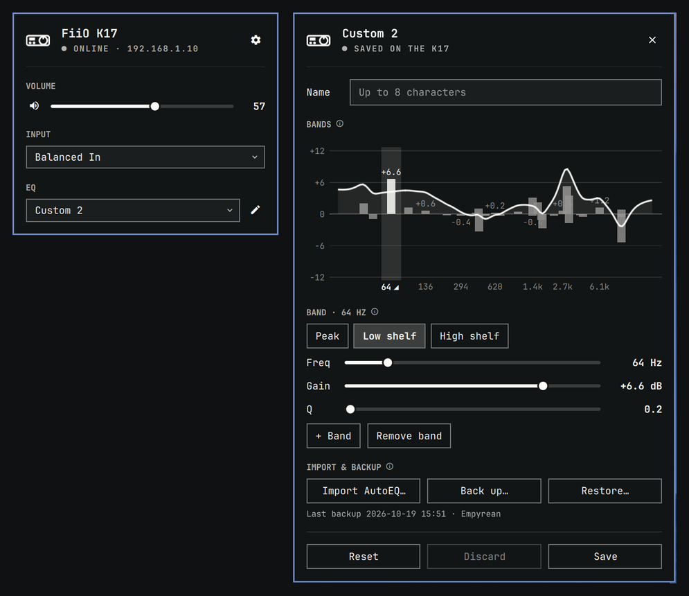

# FiiO K17 for Omarchy

Control a [FiiO K17](https://www.fiio.com/k17) desktop DAC/amp over your network from the
Omarchy bar: volume, mute, input, and EQ. The volume keys can drive the K17 directly,
and the K17 becomes your system output automatically while it is in USB mode.



## Features

- **Bar widget** showing any combination of input, EQ, and volume, e.g.
  `BAL · Jazz · 34`, or a compact `K17`, dimmed while not connected. Click for the panel, scroll for volume,
  right-click to mute.
- **Panel** with volume slider, mute button, input selection, and EQ selection
  (presets and your named custom EQs).
- **Custom EQ editor** for the K17's ten custom slots: a graphic view of the bands
  with the combined response curve (click to select, drag to set gain), peak and
  shelf filters, frequency, gain (±12 dB), Q, renaming, and discard.
- **AutoEQ import**: pick a `ParametricEQ.txt` from [AutoEQ](https://autoeq.app) in the
  system file dialog and load it into a custom slot (up to 31 filters).
- **EQ backups** of all ten custom EQs to a file of your choice, and restore from one.
  Restoring backs up the current EQs first (to `~/.local/share/fiio-k17/backups`).
- **Network search** for the K17 (same network segment). Changes play live; *Save*
  stores them on the K17.
- **Volume keys** control the K17 with the regular Omarchy OSD, and fall back to the
  normal system volume whenever the K17 is off, unreachable, or released.
- **Automatic USB output** (opt-in): while the K17's input is USB it appears as a USB audio
  device; the plugin makes it the default output and switches back to whatever was
  the default before once the K17 leaves USB mode.

## Requirements

- Omarchy with the Quickshell-based `omarchy-shell`
- `python3`, `pactl` (PipeWire), `ping`
- For the file dialogs: `xdg-desktop-portal` with a FileChooser backend (Omarchy ships
  the GTK one) and PyGObject, or `zenity` as a fallback
- K17 on the same network (Ethernet or Wi-Fi). Its IP address is shown on the
  device under Settings > About.

## Install

```bash
omarchy plugin add https://github.com/homelabsealinsideout/omarchy-fiio-k17 --enable
```

Then click the `K17` entry in the bar. The panel opens on its settings the first
time; enter the K17's IP address and press Enter.

### Volume keys (optional)

Add this to `~/.config/hypr/bindings.lua` to let the media keys drive the K17. With
the K17 off or unreachable they keep working as normal system volume keys.

```lua
hl.unbind("XF86AudioRaiseVolume")
hl.unbind("XF86AudioLowerVolume")
hl.unbind("XF86AudioMute")
o.bind("XF86AudioRaiseVolume", "K17 volume up", "~/.config/omarchy/plugins/io.github.homelabsealinsideout.fiio-k17/bin/k17-vol key up", { locked = true, repeating = true })
o.bind("XF86AudioLowerVolume", "K17 volume down", "~/.config/omarchy/plugins/io.github.homelabsealinsideout.fiio-k17/bin/k17-vol key down", { locked = true, repeating = true })
o.bind("XF86AudioMute", "K17 mute", "~/.config/omarchy/plugins/io.github.homelabsealinsideout.fiio-k17/bin/k17-vol key mute", { locked = true })
```

## Settings

Open them with the gear in the panel header (or `omarchy-shell io.github.homelabsealinsideout.fiio-k17 settings`).
Hover a setting with the 󰋽 icon for an explanation. They are stored on the widget's
entry in `~/.config/omarchy/shell.json`.

| Setting | Default | |
|---|---|---|
| IP address | – | Network address of the K17; *Search* finds K17s in the same network |
| Release for the FiiO app | off | See below |
| Bar shows | Input, Volume | Any of input, EQ, and volume; none shows a compact `K17` |
| Volume keys: control the K17 | on | Turn off to give the keys back to the system volume |
| Volume keys: limit | 100 | Keys and scrolling never go louder than this; levels set on the knob are kept |
| Auto-switch to K17 USB | off | Automatic USB output switching described above |

EQ import and backups live in the EQ editor (pencil next to the EQ selection).

Settings can also be changed from scripts:

```bash
omarchy-shell io.github.homelabsealinsideout.fiio-k17 set barEq true
omarchy-shell io.github.homelabsealinsideout.fiio-k17 editEq      # open the EQ editor
```

## Remove

```bash
omarchy plugin remove io.github.homelabsealinsideout.fiio-k17
```

If you added the volume-key bindings, delete them from `~/.config/hypr/bindings.lua`
again. EQ backups stay in `~/.local/share/fiio-k17/backups` until you delete that folder.

## Things to know

- **One client at a time.** The K17 accepts a single network connection, which the
  plugin holds. To use the FiiO Control app, turn on *Release for the FiiO app*, and turn it off again afterwards.
- **Mute** sets the volume to 0 and restores it on the next press. The K17 has no
  network mute; the mute you get by pressing the knob is separate and can't be read
  over the network.
- **Unofficial.** This uses the undocumented protocol of the FiiO Control app, tested
  with K17 firmware 265. A firmware update can break it. Details in
  [docs/PROTOCOL.md](docs/PROTOCOL.md).

## Command line

`bin/k17-vol` talks to the plugin's background daemon:

```bash
k17-vol status          # JSON status
k17-vol set 30          # volume 0-100
k17-vol up | down | mute
k17-vol input 5         # 1 USB, 2 Optical, 3 Coaxial, 4 Line In, 5 Balanced In, 6 Bluetooth, 7 Streaming, 8 Local Play
k17-vol eq 0xFF         # EQ codes in docs/PROTOCOL.md
k17-vol eqbands         # bands of the active EQ as JSON
k17-vol eqset JSON      # apply bands live (custom EQs only)
k17-vol eqsave | eqreset   # reset is stored on the K17 at once
k17-vol eqname 0xA1 Test   # rename a custom slot (8 bytes)
k17-vol eqautoeq "Some Headphone ParametricEQ.txt"   # into the active custom EQ, live
k17-vol eqbackup [FILE] | eqbackups | eqrestore FILE
k17-vol discover
```

## Disclaimer

This is an unofficial community project. It is not affiliated with, endorsed by, or
supported by FiiO. FiiO and K17 are trademarks of FiiO Electronics Technology Co., Ltd.
The plugin talks to the K17 the same way the FiiO Control app does; use it at your own risk.

## License

MIT
